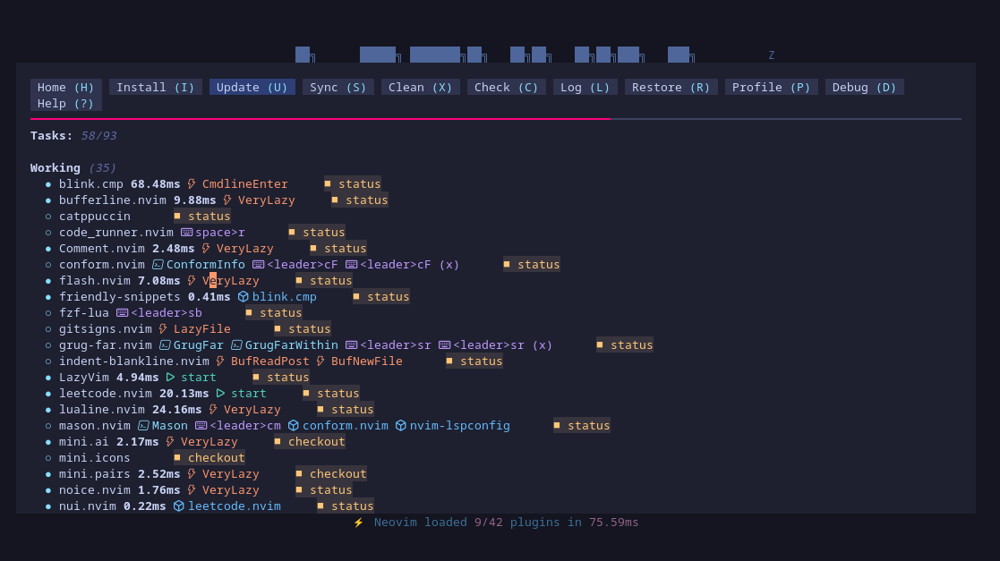
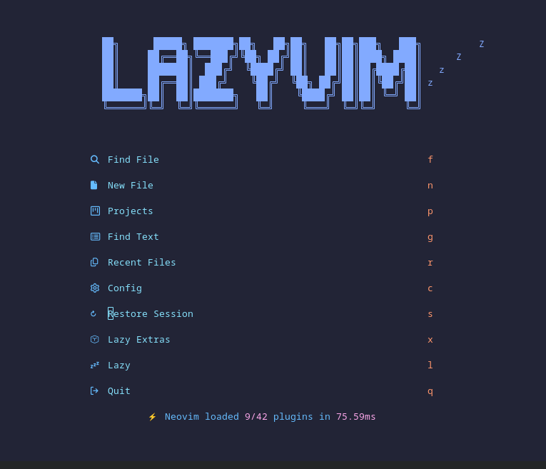

### 📸 Visual Showcase

<div align="center">
  
</div>

<details>
<summary><strong>Click to view more screenshots</strong></summary>
<br/>

| View 1 | View 2 |
| :---: | :---: |
|  |  |

</details>

# 🚀 Personal Neovim Configuration


A modern, cross-platform, IDE-grade Neovim configuration built for speed, competitive programming, and software development. Designed to deploy seamlessly across desktop Linux environments (such as CachyOS/Arch) and mobile terminal setups (Termux on Android) using a single universal installation script.

---

## ✨ Key Features

* **Universal Portability:** One-command deployment via a smart `install.sh` script that automatically detects paths, creates missing directories, and safely backs up existing setups.
* **Symlink Architecture:** Links the cloned repository directly to `~/.config/nvim`, allowing instant updates across all devices with a simple `git pull`.
* **IDE-Grade Tooling:** Pre-configured with **LazyVim / `lazy.nvim`**, **Telescope** (fuzzy finding), **Tree-sitter** (syntax parsing & highlighting), **Catppuccin** colorscheme, indent guides, a built-in code runner, and **LeetCode (`leetcode.nvim`)** integration.

---

## 📋 Prerequisites

Before running the setup, ensure you have the following core dependencies installed on your system:

* **Neovim** (`v0.9.0` or higher)
* **Git**
* **C Compiler** (`gcc` or `clang`) — *Required for compiling Tree-sitter parsers*
* **Ripgrep (`rg`) & `fd`** — *Required for Telescope live grep and fast file searching*
* **`curl`** — *Required for plugin downloads and `leetcode.nvim`*
* **A Nerd Font** — *Required in your terminal emulator for file icons and UI glyphs*

### Quick Dependency Installation

**Arch Linux / CachyOS:**
```bash
sudo pacman -S neovim git base-devel ripgrep fd curl
```

**Ubuntu / Debian:**
```bash
sudo apt update && sudo apt install -y neovim git build-essential ripgrep fd-find curl
```

**Android (Termux):**
```bash
pkg update && pkg install -y neovim git clang ripgrep fd curl
```

---

### ⚡ Interactive Code Runner

Press **`<F5>`** to **`<F5>`** / **`<Space>r`** in Normal mode to automatically save, compile (with `-Wall -Wextra -O2`), and execute your active file inside an interactive bottom terminal split that supports standard input (`scanf`, `std::cin`, `input()`):

| Keybinding | Mode | Supported Languages | Behavior |
| :--- | :---: | :--- | :--- |
| **`<F5>`** | Normal | `C` (`gcc`) · `C++` (`g++`) · `Python` (`python3`) | Auto-saves file, compiles to binary, and launches interactive terminal |

| **`<Space>a`** | Normal | `C` (`gcc`) · `C++` (`g++`) | Compiles with `-O2 -S -masm=intel` and opens clean x86_64 assembly side-by-side |
| **`<Space>db` / `<Space>dc`** | Normal | `C` · `C++` · `Python` | Toggles breakpoints and launches interactive `nvim-dap` memory/register debugger |


### 🎨 Visual & IDE Enhancements

Engineered for maximum visual clarity on OLED displays and high-contrast syntax readability across desktop and mobile:

| Feature | Plugin | Description |
| :--- | :--- | :--- |
| **Pure OLED Black & Neon Palette** | `catppuccin/nvim` | Forces `#000000` pitch-black across all UI panes while boosting syntax colors for keywords, types, functions, and operators |
| **7-Color Rainbow Brackets** | `rainbow-delimiters.nvim` | Color-codes nested `()`, `{}`, and `[]` across seven vivid tiers |
| **Rainbow Indent Guides** | `indent-blankline.nvim` | Vertical indentation lines matched to the 7-color bracket palette with active scope highlighting |
| **Top Symbol Breadcrumbs** | `dropbar.nvim` | Interactive navigation bar showing file path and active function/struct scope (`<Space>;` to jump) |
| **Inline Color Swatches** | `nvim-colorizer.lua` | Renders live background color previews directly on `#Hex` and `rgb()` codes |
| **Smooth IDE Scrolling** | `neoscroll.nvim` | Fluid quadratic scroll animations for `<C-u>`, `<C-d>`, `<C-b>`, and `<C-f>` |
| **Coding Telemetry** | `vim-wakatime` | Automatic time and language tracking synced to GitHub profile metrics |


## 🛠️ Universal Installation

Follow these steps to deploy this configuration on any new machine or phone:

### 1. Clone the Repository
```bash
git clone https://github.com ~/nvim-config
```

### 2. Run the Installer Script
```bash
chmod +x ~/nvim-config/install.sh
~/nvim-config/install.sh
```

#### What `install.sh` does under the hood:
1. Automatically resolves the exact directory where the repository was cloned.
2. Ensures `~/.config` exists (crucial for fresh Termux or minimal Linux installations).
3. Checks for any pre-existing Neovim configuration at `~/.config/nvim` and safely moves it to a timestamped backup (`~/.config/nvim.backup.YYYYMMDD_HHMMSS`).
4. Creates a symbolic link (`ln -s`) from the cloned repo to `~/.config/nvim`.

### 3. Bootstrap Plugins
Launch Neovim for the first time:
```bash
nvim
```
Your plugin manager will automatically open and download all configured plugins. Allow all progress bars to complete before closing.

---

## 📱 Termux (Android) Specific Setup

If you are deploying this configuration on an Android device using Termux, complete these two extra steps after running `install.sh`:

1. **Create the Neovim cache directory** (prevents startup crashes for plugins like `leetcode.nvim`):
   ```bash
   mkdir -p ~/.cache/nvim
   ```
2. **Verify system health inside Neovim:**
   Open `nvim` and run `:checkhealth` to confirm all parsers and CLI tools (`rg`, `fd`, `clang`) are detected properly.

---

## 🔄 Keeping Devices in Sync

Because `install.sh` uses a symlink, keeping your desktop and phone synchronized requires zero re-installation:

* **Push changes from your primary machine:**
  ```bash
  cd ~/.config/nvim
  git add .
  git commit -m "Update Neovim configuration"
  git push
  ```
* **Pull updates onto any other device:**
  ```bash
  git -C ~/nvim-config pull
  ```
  *(Restart Neovim to apply any newly added plugins).*

---

## 🩺 Troubleshooting

* **Plugins fail to build on first launch:** Open Neovim, run `:Lazy`, highlight the failed plugin, and press `gb` (Build) or `U` (Update).
* **Broken icons or missing symbols:** Make sure your terminal emulator (or Termux styling app) is using a patched **Nerd Font** (e.g., *JetBrainsMono Nerd Font* or *FiraCode Nerd Font*).
* **Check overall setup status:** Run `:checkhealth` inside Neovim for detailed diagnostics.

---

### Credits & Acknowledgments

* **[@folke](https://github.com)** — LazyVim
* **[@catppuccin](https://github.com)** — Catppuccin Theme
* **[@HiPhish](https://github.com)** — rainbow-delimiters.nvim
* **[@lukas-reineke](https://github.com)** — indent-blankline.nvim
* **[@Bekaboo](https://github.com)** — dropbar.nvim
* **[@NvChad](https://github.com)** — nvim-colorizer.lua
* **[@karb94](https://github.com)** — neoscroll.nvim
* **[@linux-cultist](https://github.com)** — venv-selector.nvim
* **[@kawre](https://github.com)** — leetcode.nvim
* **[@wakatime](https://github.com)** — vim-wakatime


**If I have missed any mentions please raise the issue**
